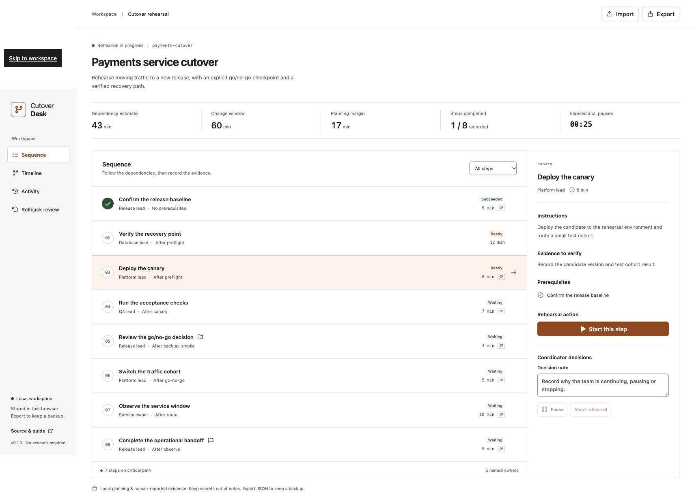

# Cutover Desk

**Plan the sequence. Rehearse the handoff. Keep the evidence.**

[Open the workbench](https://abrjrocks.github.io/cutover-desk/) · [Integration guide](docs/workflow.md) · [Example document](examples/payments-cutover.json)

[](https://github.com/ABRJrocks/cutover-desk/actions/workflows/ci.yml)
[](LICENSE)

A browser workbench for engineering leads preparing a deployment or migration. Build a dependency-aware runbook, inspect its critical path, rehearse the sequence and record the evidence behind each decision. Export a reusable plan or a Markdown report for an issue, wiki or retrospective.

The app is **local-first and human-operated**. It does not connect to your infrastructure, execute commands or treat a note as a verified approval. No account or API key is required.



## A complete rehearsal, not another checklist

- **Dependency planning:** validate prerequisite IDs, reject circular plans, calculate earliest starts and scheduling float, and highlight the critical path.
- **Owner awareness:** name the person or role for each step and warn about overlaps in the dependency-only estimate.
- **Evidence before progression:** start ready steps, record an outcome, and unlock their dependents after success.
- **Failure decisions:** a failed step pauses progression. A coordinator records why to resume and retry, or aborts the rehearsal.
- **Recovery review:** show instructions for every touched step in reverse dependency order, including failed and unfinished work.
- **Portable handoff:** export plan JSON, resumable workspace JSON or a readable Markdown record. Imported histories are replay-validated.
- **Browser recovery:** retain work across reloads, surface storage failures, preserve corrupt saved text and detect stale-tab writes.

The included payments cutover demonstrates parallel preparation, an explicit go/no-go gate, traffic review, observation and handoff. It is example planning data, not an instruction to modify a real payments system.

## Try it

Open the [hosted workbench](https://abrjrocks.github.io/cutover-desk/), select **Start rehearsal**, enter a coordinator name and begin with the release baseline. Try recording a failure during the canary, then enter a decision note and resume. The earlier failure remains in Activity.

To use your own plan, select **Edit plan**, edit or add steps, and choose their prerequisites. Each step needs instructions, evidence to verify and rollback review text. Plans become read-only during a rehearsal so edits cannot silently change the active sequence.

Export the workspace before replacing it or starting a new rehearsal. A single coordinator operates one browser tab at a time. Send the exported JSON file to hand the workspace to another coordinator; there is no live synchronization.

## Run locally

Use Node.js **22.12+ or 24+** and npm:

```bash
git clone https://github.com/ABRJrocks/cutover-desk.git
cd cutover-desk
npm ci
npm run dev
```

Build the static app:

```bash
npm run build
npm run preview
```

The default Vite server binds to `127.0.0.1`. Serve the built `dist/` directory using a local or internal static web server. Opening `index.html` directly through `file://` is not supported. The release also includes a prebuilt static archive, so an end user does not need Node to serve it. Assets and fonts are self-contained. A fresh visit to the hosted demo needs network access; this is not an installable offline PWA.

## Bring it into a process

| Existing workflow | Cutover Desk handoff |
| --- | --- |
| Release planning | Save plan JSON beside the release or migration documentation |
| Tabletop rehearsal | One coordinator records steps, decisions and evidence notes |
| Review meeting | Export Markdown into an issue, wiki or change record |
| Coordinator handoff | Export workspace JSON and import it in the receiving browser |
| Reuse for the next release | Export plan JSON without the previous rehearsal history |

The [workflow guide](docs/workflow.md) documents the file contract, failure behavior and how to adapt the example. The [research notes](docs/research.md) explain the scope and existing alternatives.

## What the estimates mean

The scheduler uses task durations and dependencies. Parallel independent steps can overlap. The change-window margin is the window minus the dependency estimate. A zero-slack step is on a critical path; there can be several such paths.

The estimate does **not** schedule staff, reserve resources, forecast network latency or account for pauses. Shared-owner overlaps are warnings for human review. Rehearsal elapsed time includes pauses. A completed rehearsal means the coordinator recorded all steps as successful, not that production was checked.

Rollback review is an ordered reading aid. Operators must assess actual routing, data consistency and irreversible effects before acting. No rollback commands are executed or verified.

## Storage and privacy

The app stores a single workspace under `cutover-desk.document.v1` in browser local storage. Notes and names are plaintext. Clearing browser data can remove the workspace, and browser storage is not a backup. Export JSON regularly and do not put passwords, tokens or personal customer data in notes.

The hosted demo serves static assets through GitHub Pages. The application makes no document-upload or analytics requests. GitHub still receives ordinary page and asset requests. Browser storage is scoped to an **origin**, not a repository path: other code served from `abrjrocks.github.io` shares that origin. Use your own dedicated origin or a local server for work that should not share that boundary. See [security](SECURITY.md).

Two-tab detection reduces accidental overwrites; local storage does not offer atomic compare-and-swap transactions. Near-simultaneous writes can still race. This release is designed for one active coordinator tab. Exported histories are editable and provide no tamper evidence, authenticated identity or compliance-grade audit trail.

## Verify the implementation

```bash
npm test
npm run build
npx playwright install chromium
npm run test:e2e
npm run format:check
```

Core tests cover malformed plans, critical-path scheduling, transition guards, import validation and storage failures. Browser tests cover the full rehearsal, failure/retry, real export downloads, editing errors, import preservation, stale tabs, corrupt-data recovery, mobile layout and automated accessibility checks. CI runs core checks on Node 22 and 24 and tests the production build in Chromium before deploying.

Automated accessibility checks are a useful baseline, not a complete accessibility conformance audit. Firefox and Safari are not part of the automated release matrix.

## Contributing

Read [CONTRIBUTING.md](CONTRIBUTING.md) for the development workflow and [CHANGELOG.md](CHANGELOG.md) for release changes. Keep the tool focused on portable human rehearsal. Infrastructure execution, team accounts and a hosted document database belong to a different scope.

MIT licensed. Maintained by [Abdul Rafay](https://github.com/ABRJrocks).
